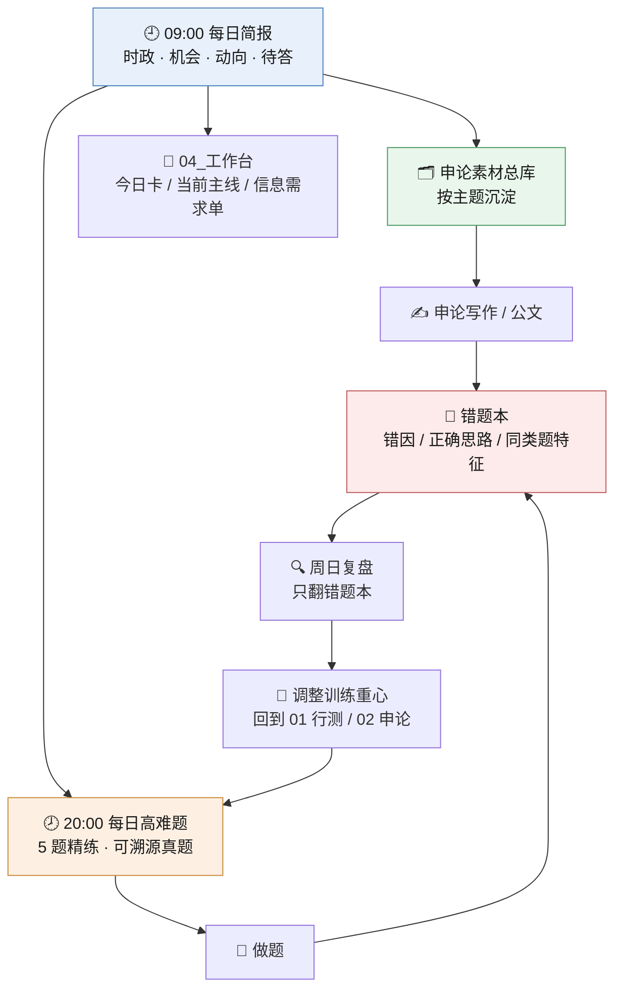

# 🔄 备考闭环与节奏

> **本页是整套公考体系的「总装图」** —— 回答三个问题：
> **① 各个文件谁管什么？ ② 每天/每周/每月干什么？ ③ 输入怎么变成成绩？**
> **冲突时以本页为准**（题量口径、节奏，全库统一到这里）。

[[00_公考总览与时间地图|← 总览]] ｜ [[01_行测能力拆解与训练法]] ｜ [[02_申论能力拆解与训练法]] ｜ [[00_申论素材总库]] ｜ [[00_刷题总览与错题本]]

---

## 一、★ 闭环图（一张图看懂整套体系怎么转）

> **一句话**：**简报喂素材 → 素材喂申论 → 高难题喂行测 → 错题本喂下一轮**。四步缺一，练了不涨。

---

## 二、★ 各文件职责表（谁管什么 · 不重复不遗漏）

| 文件 / 位置 | 职责 | 谁来维护 | 更新频率 |
|---|---|---|---|
| `00_公考总览与时间地图.md` | **入口**：资格自查 · 考试时间地图 · 目标方向 · 红线 | 人工（本人拍板） | 考试政策变化时 |
| `01_行测能力拆解与训练法.md` | **行测怎么练**：五模块方法 · 答题顺序 · 阶段节奏 | 人工 | 首测后调整 |
| `02_申论能力拆解与训练法.md` | **申论怎么练**：五题型 · 万能四步法 · 公文文种 | 人工 | 首测后调整 |
| `03_时政积累/00_申论素材总库.md` | ★ **素材沉淀**：提法 / 硬数字 / 案例库 / 重点专题 | **《每日简报》自动追加** | **每天** |
| `03_时政积累/2026-10-09_时政周报.md` | **创刊号存档**（建库前的素材原始出处） | 存档不再更新 | — |
| `04_每日刷题/00_刷题总览与错题本.md` | ★ **练习与沉淀**：出题节奏 · 难度分级 · **错题本** · 战绩表 | **本人填**（自动出题） | 每天记一行 |
| `05_备考闭环与节奏.md`（本页） | ★ **总装**：闭环图 · 职责表 · 日/周/月节奏 · 题量口径 | 人工 | 体系调整时 |
| `04_工作台/每日简报_YYYY-MM-DD.md` | **每日输入**：消息 · 时政 · 机会 · 动向 | **自动化 09:00** | 每天 |
| `04_每日刷题/YYYY-MM-DD_高难题.md` | **每日练习**：5 题（周日 10 题 / 周六 1 道申论） | **自动化 20:00** | 每天 |

---

## 三、★ 题量口径（**全库统一 · 以此为准**）

> ⚠️ **历史冲突已解决**：`01` 曾写「每天 40 题」、`02` 曾写「每天 1 道小题」、`04` 实际出「5 题」—— 三者口径不一。
> **统一解释如下**：

| 名称 | 是什么 | 数量 | 来源 |
|---|---|---|---|
| **高难题精练** | **拉分题专项**，自动化出，只出 🟠/🔴 | **5 题 / 天**（周日 10 题 · 周六 1 道申论大题） | **自动化 20:00** |
| **日常刷题量** | 行测**总**题量（含上面的高难题） | 见 §四 分阶段 | 教材 / 真题卷自选 |
| **申论小题** | 手写，练「找得准 + 写得规范」 | **1 道 / 天** | 真题卷自选 |
| **资料分析专项** | 整篇材料限时 | **1 篇 / 天** | 真题卷自选 |

> **★ 关键理解**：**自动化出的 5 题 ≠ 当天全部题量**，它只是**最硬的那 5 题**。
> 剩下的量由你自己从真题卷里补 —— **自动化的价值是「保证每天至少有一组高质量拉分题」，不是替你刷完全部**。

---

## 四、★ 日 / 周 / 月节奏

### 4.1 每天

| 时段 | 动作 | 时长 | 产出 |
|---|---|---|---|
| **09:00** | 读《每日简报》：先看**今日必看 3 条** → 消息更新 → 时政 → 机会 | 10 分钟 | 简报自动生成 |
| **白天** | 自选：**行测 N 题 + 1 篇资料分析 + 1 道申论小题（手写）** | 50 分钟 | 记入战绩表 |
| **20:00** | 做《每日高难题》5 题（**限时 · 先写后对**） | 15 分钟 | 自动生成题目 |
| **做完立刻** | 记一行战绩 + 错的写进错题本（**只写三行**） | 5 分钟 | 错题本 |

### 4.2 每周

| 时间 | 动作 |
|---|---|
| **周一** | 《每日简报》自动附「**本周时政汇总**」—— 集中过一遍上周素材 |
| **周三前** | ⚠️ 另一条线（中传旁听预约），**不属于本体系**，见 [[信息需求单_20261009]] |
| **周六** | 《每日高难题》＝**申论高难题 1 道大题**（整块时间，**手写**） |
| **周日** | 《每日高难题》＝**五模块综合硬卷 10 题（限时 25 分钟）** + **本周错题复盘提示** |
| **周日** | ★ **复盘**：只翻错题本，不翻新题；素材库只看「本周新增」 |

### 4.3 每月

| 时间 | 动作 |
|---|---|
| **每月最后一周** | 一次**完整套题模考**：行测 120 分钟 + 申论 180 分钟（**打基础期后可上**） |
| **每月末** | 回看战绩表：**正确率曲线 + 单题用时**是否改善；把重复 ≥3 次的错因开专项页 |

---

## 五、★ 分阶段题量（对齐 [[01_行测能力拆解与训练法]] §四）

| 阶段 | 时间 | 行测日常量 | 申论 | 说明 |
|---|---|---|---|---|
| **预热期**（现在） | 2026-10 | **高难题 5 题** + 少量自选 | 1 道小题 / 天 | ★ **只摸基线，不追量**。首测没做完之前不上强度 |
| **打基础** | 2026-11 → 2027-03 | **40 题**（含高难题 5）+ 1 篇资料分析 | 每周 3 道归纳概括 + 1 篇公文 | 主攻**资料分析 + 判断推理** |
| **补短板** | 2027-04 → 2027-06 | 40 题 + **每周 1 套真题** | 每周 1 篇完整大作文 | 言语 + 数量（只抓必考） |
| **强化** | 2027-07 → 2027-09 | **每周 2 套限时套题** + 错题复盘 | 每周 1 套完整申论 | 常识跟时政走 |
| **冲刺** | 2027-10 → 考前 | 真题 + 模考，**固定答题顺序** | 真题复盘 + 素材成册 + 练字 | 练考场节奏 |

> **★ 铁律**：**任何一题超过 90 秒就放弃**。宁可天天做，不要一天做爆。

---

## 六、★ 两条自动化（已上线 · 谁在什么时候跑）

| 时间 | 名称 | 干什么 | 产出 |
|---|---|---|---|
| **每天 09:00** | 《每日简报》 | 读 Obsidian → 微信增量同步 + 24h 消息 → 时政 → 新增机会 → 时局动向 → **追加素材到总库** | `04_工作台/每日简报_YYYY-MM-DD.md` |
| **每天 20:00** | 《每日高难题》 | 按星期轮换模块 → 联网挑**可溯源真题**（🟠/🔴）→ 解析 + 易错点 + 记录位 | `04_每日刷题/YYYY-MM-DD_高难题.md` |

**★ 两条的握手**：
- 早 09:00 简报**末尾提示今晚刷题主题**（周几 → 练什么）。
- 晚 20:00 高难题**先读当天简报的时政部分** —— 周六的申论题优先从**当天素材**里取题。

---

## 七、⚠️ 红线

1. **题量与节奏冲突时，以本页 §三 / §四 为准**（历史上有三处口径打架，已统一）。
2. **不得**在首测完成前把日常量拉到 40 题 —— **先摸基线，再加量**。
3. **不得编造题目 / 答案** —— 见 [[00_刷题总览与错题本]] §六。
4. 本体系**只用于能力建设**，与微信隐私数据**完全隔离**。
5. **不替他决定考哪个方向、报哪个岗位**。

---

关联：[[00_公考总览与时间地图]] · [[01_行测能力拆解与训练法]] · [[02_申论能力拆解与训练法]] · [[00_申论素材总库]] · [[00_刷题总览与错题本]]

*来源：2026-10-10 体系总装（解决三处口径冲突）*
